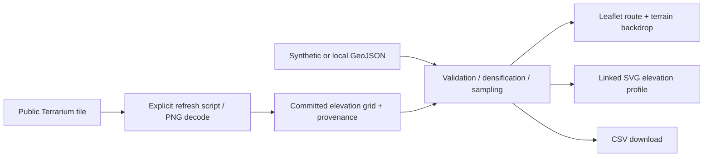

# Terrain-aware route explorer

Compare two illustrative alignments against public elevation data near Boulder, Colorado. A Leaflet map, linked elevation profile, grade highlighting, and CSV export make the terrain tradeoffs inspectable.

**[Open the demo](https://freddie999.github.io/terrain-route-explorer/)** · [Source data provenance](public/data/provenance.json)

**Status:** independent engineering demonstration, not a route optimizer, navigation product, or flight-planning system. Built for Frederick Abalo's portfolio with AI-assisted implementation. The alignments are synthetic; the elevations are real public data. No Zipline code, routes, or operational data is used.


## Run locally

Requires Node 24 (a `mise.toml` is included).

```sh
git clone https://github.com/Freddie999/terrain-route-explorer.git
cd terrain-route-explorer
mise install  # optional if Node 24 is already installed
npm ci
npm run dev
# Open the localhost URL printed by Vite
npm test
npm run build
npm run preview
```

The elevation tile and route samples are committed, so analysis needs no token, account, or elevation API. OpenStreetMap basemap tiles require internet; the bundled elevation backdrop, route, and profile remain usable without them. `npm run data:refresh` explicitly re-downloads the fixed public tile and rewrites its URL, retrieval time, and SHA-256 provenance. Review resulting changes before committing.

## What to inspect

1. Switch between **Foothill traverse** and **Valley approach** and compare length, ascent, and maximum absolute grade.
2. Change sample spacing. Finer spacing changes estimates but cannot improve the native elevation data's resolution.
3. Move over the profile to locate a sample on the map.
4. Adjust the grade threshold; steep segments turn orange.
5. Upload a WGS84 GeoJSON LineString Feature within the coverage box, or export the sampled profile as CSV. Uploads stay in the browser.

## Architecture and contribution



The implementation covers the ingestion/provenance script, coordinate and sampling math, map/profile interaction, upload validation, export, automated tests, and GitHub Pages deployment. Pure analysis code is separated from browser I/O in `src/terrain.js`. The existing Geomersive tile library was assessed first; it computes integer tile indices, while this application needs fractional pixel positions and raster interpolation, so this demonstration uses independently written sampling code.

## Methods and decisions

- Horizontal distance uses the haversine formula with mean Earth radius 6,371,008.8 m.
- Each line segment is linearly densified in lon/lat at up to the selected spacing (short local routes only); original vertices are retained. This is not network routing or geodesic densification.
- Elevation comes from bilinear interpolation around **pixel centers**, decoded as `R*256 + G + B/256 - 32768` metres.
- Ascent/descent sum positive/negative sample differences. Grade is elevation change / horizontal sample distance × 100. Maximum grade is the largest absolute sampled grade, not a terrain-wide maximum.
- One zoom-11 tile bounds both network cost and the reproducible example. Out-of-coverage inputs fail; no zero-elevation fallback is used. Coverage is slightly inset at pixel centers because edge interpolation needs data.
- Leaflet provides an accessible, lightweight 2D map without proprietary tokens. No 3D rendering or false precision is needed to explain the comparison.

## Limitations

The terrain tile has ~59 m horizontal pixel spacing around 40°N. Tile resolution is not a guarantee of source accuracy. This blended public DEM may have source seams, differing acquisition dates, and vertical-reference differences. No datum conversion, smoothing, building/vegetation model, road legality, route feasibility, airspace, weather, or clearance analysis is implemented. Grade/ascent depend on sampling and DEM noise. User routes are restricted to 2–2,000 vertices and 1 m–50 km; antimeridian crossings and 3D coordinates are rejected. Routes are **not verified roads or trails**.

## Validation and CI

`npm test` checks known geodesic distances, Terrarium decoding, bilinear interpolation, missing/edge coverage, flat terrain, sampling limits, malformed routes, bundled-data coverage, and reversal symmetry of ascent/descent. CI installs from the lockfile, runs tests, builds the app, and deploys the default branch to Pages. Browser checks cover both route options and the rendered profile.

## Data attribution

Terrain Tiles was accessed on the date recorded in [provenance.json](public/data/provenance.json) from the [AWS Open Data Registry](https://registry.opendata.aws/terrain-tiles/). The bundled numeric grid is a decoded copy of `terrarium/11/424/775.png` with no smoothing or datum conversion. Elevation sources: Mapzen Terrain Tiles; United States 3DEP and global GMTED2010/SRTM courtesy of USGS; global ETOPO1 from NOAA. [Full source attribution and terms](https://github.com/tilezen/joerd/blob/master/docs/attribution.md). Government-source terrain is separate from the code license and is not endorsed by its providers.

Basemap: © [OpenStreetMap contributors](https://www.openstreetmap.org/copyright). Route coordinates were created for this demonstration and do not represent operational paths. Leaflet is BSD-2-Clause; Vite is MIT; pngjs is MIT. Independently written application code is [MIT licensed](LICENSE).
